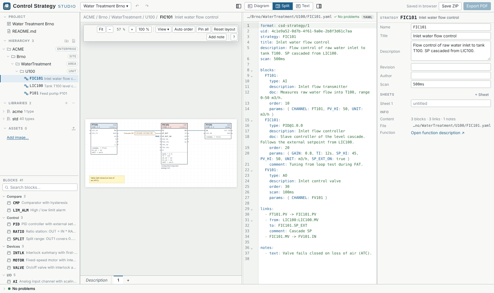

<p align="center">
  
</p>

<p align="center">
  <b>Write control strategies once — share them with every plant, whatever DCS it runs.</b><br>
  CFC-style function block diagrams you can edit as a drawing <i>or</i> as text, version with git and hand over as PDF.
</p>

<p align="center">
  <a href="https://javor55.github.io/ControlStrategyStudio/"><b>Open the app</b></a> ·
  <a href="https://javor55.github.io/ControlStrategyStudio/control-strategy-studio.html">Download for offline use</a> ·
  <a href="#project-format">Project format</a> ·
  <a href="#development">Development</a>
</p>

<p align="center">
  
</p>

---

## Why

* **Abstract blocks** — AI, PID, interlock … defined only by their interface (inputs,
  outputs, parameters). No mapping to a vendor; the integrator implements it in the
  plant's DCS.
* **Text and drawing are the same thing** — every strategy is a readable YAML file.
  Edit it on the canvas, in the text editor, or side by side; both stay in sync,
  including your `#` comments.
* **Made for review and hand-over** — function descriptions in Markdown, revisions,
  title block, PDF export *(coming in phase 3)*.

## Features

| | |
|---|---|
| **Canvas** | CFC-like blocks with ports, constants and parameters · drag blocks · draw links port to port · several sheets per strategy with off-sheet connectors · links to other strategies with “used by” tags · automatic layout, positions stored only for blocks you move · execution order (auto order) · notes |
| **Text** | YAML editor with syntax check, problem markers, context-aware completion and hover help · selection follows between text and drawing · Diagram / Split / Text modes |
| **Blocks** | Standard library `std` (41 blocks: I/O, logic, timers, comparators, math, selectors, filters, PID, ratio, split range, motor, valve, interlock) · your own libraries as plain folders · versioned block types · composite blocks with an inner diagram · graphical block type editor |
| **Project** | ISA-95 / ISA-88 hierarchy (Enterprise → Site → Area → Unit → …) · Markdown documentation with images · validation with clear messages (unknown ports, type mismatch, double drivers, wrong references …) |
| **Files** | Runs in the browser, works offline · autosave in the browser · projects travel as ZIP · git-friendly text files |

## Use it

* **Online:** <https://javor55.github.io/ControlStrategyStudio/> — nothing to install.
  Projects are stored in your browser; use **Save ZIP** to keep or share them.
* **Offline:** download
  [`control-strategy-studio.html`](https://javor55.github.io/ControlStrategyStudio/control-strategy-studio.html)
  and open it by double-click. The whole application is this one file.

The first start opens a demo project (a water intake with a level/flow cascade and a
pump with dry-run protection). **Project ▾ → New project** starts an empty one.

### Keyboard

| Keys | Action |
|---|---|
| `Ctrl+Z` / `Ctrl+Y` | Undo / redo |
| `Ctrl+C` `Ctrl+X` `Ctrl+V` | Copy, cut, paste blocks (also between strategies and projects; the clipboard holds YAML) |
| `Ctrl+D` / `Ctrl+A` | Duplicate / select all |
| `Delete` | Delete selection |
| Arrows | Move selection (with `Shift` by 50 px) |
| Wheel / `Ctrl`+wheel | Scroll / zoom |
| Double-click on paper | Insert a block |
| `Alt+1` `Alt+2` `Alt+3` | Diagram / Split / Text mode |
| `Ctrl+B` / `Ctrl+Alt+B` | Hide the left / right panel |
| `Ctrl+S` | Save project as ZIP |
| `?` | All canvas shortcuts |

## Project format

A project is a folder of text files (inside a ZIP when shared):

```
project.yaml                         name, hierarchy levels, title block
README.md                            project introduction
library/
  std/                               a library = a self-contained, copyable folder
    library.yaml
    PID@1.0.0.yaml                   one file per version of a block type
  acme/
    AI_2OO3@1.0.0.yaml               composite block (inner diagram)
strategies/
  ACME/Brno/WaterTreatment/U100/     folders = hierarchy levels
    README.md                        description of the unit
    FIC101.yaml                      strategy
    FIC101.md                        its function description
assets/                              images used in the documentation
```

A strategy:

```yaml
format: csd-strategy/1
strategy: FIC101
title: Inlet water flow control
scan: 500ms

sheets:                       # optional — one sheet by default
  - { id: 1, title: Flow control }

blocks:
  FT101:
    type: AI
    description: Inlet flow transmitter
    order: 10
    params: { PV_HI: 50, UNIT: m3/h }
  FIC101:
    type: PID@1.0.0           # pinned version; "PID" = latest
    order: 20
    params: { GAIN: 0.8, TI: 12s, SP_EXT_ON: true }
    comment: Tuning from loop test during FAT.
  FV101:
    type: AO
    order: 30
    pos: [640, 140]           # only stored after the block was moved by hand

links:
  - FT101.PV -> FIC101.PV
  - from: LIC100:LIC100.MV    # signal from another strategy
    to: FIC101.SP_EXT
    comment: Cascade SP
  - FIC101.MV -> FV101.IN
```

Rules in short:

* Links are `BLOCK.PORT -> BLOCK.PORT`; the source may live in another strategy
  (`STRATEGY:BLOCK.PORT`). The other strategy shows a “used by” tag automatically.
* Unconnected inputs can hold constants (`SP_EXT_ON: true`), shown next to the port.
* Any key starting with `x-` is kept untouched — room for data of other systems.
* Every file carries `format: csd-<kind>/<version>`; older formats are migrated on load.
  JSON Schemas of all file kinds are in [`schema/`](schema).

## Development

```bash
npm install
npm run dev         # editor at http://localhost:5173
npm test            # unit tests (vitest)
npm run typecheck
npm run build       # → apps/web/dist/index.html (single offline file)
npm run demo        # renders the demo project to out/index.html
npm run schemas     # regenerates schema/*.json
```

Every push to `main` runs type checks and tests, builds the app and deploys it to
GitHub Pages (`.github/workflows/pages.yml`).

### Repository layout

```
packages/
  core/     @csd/core   – format, model, libraries, validation, operations, layout
                          (no UI, no browser APIs — also runs in Node / on a server)
  render/   @csd/render – SVG renderer shared by screen, PDF and CLI
apps/
  web/      @csd/web    – the editor (React + CodeMirror)
brand/      logo
schema/     JSON Schemas (generated)
```

### Architecture rules

* **All changes are operations.** Canvas, inspector, text editor and any future API
  produce `Op` objects applied by `applyOp(files, op)` (`packages/core/src/ops.ts`).
  Ops edit the YAML syntax tree, so formatting and comments survive, and return the
  previous content for undo. This is also the unit for future multi-user sync.
* **The core has no UI.** `@csd/core` must not import React or browser/Node APIs.
* **Stable identities.** Projects, strategies and block types carry a `uid`;
  diagnostics carry stable `code`s that integrations may rely on.

## Roadmap

| Phase | Content | State |
|---|---|---|
| 1 · Core | format & schemas, libraries, composite blocks, validation, operations, layout, renderer | done |
| 2 · Editor | canvas, inspector, text editor (completion, hover), project tree, palette, settings, autosave, ZIP | done |
| 3 · Hand-over | configurable export: PDF, interactive read-only HTML, JSON / TOML | done |
| 4 · Versions | git in the project: commits, revisions, branches, text and visual diff, restore | done |
| 5 · Sequences | SFC / Grafcet diagrams next to continuous strategies — [design brief](docs/design/sequences.md) | proposed |

More ideas and known gaps: [docs/ROADMAP.md](docs/ROADMAP.md).
