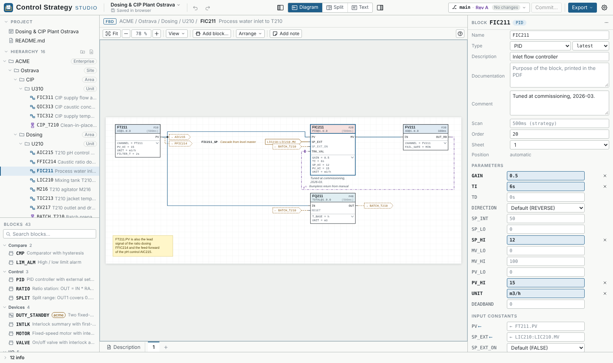
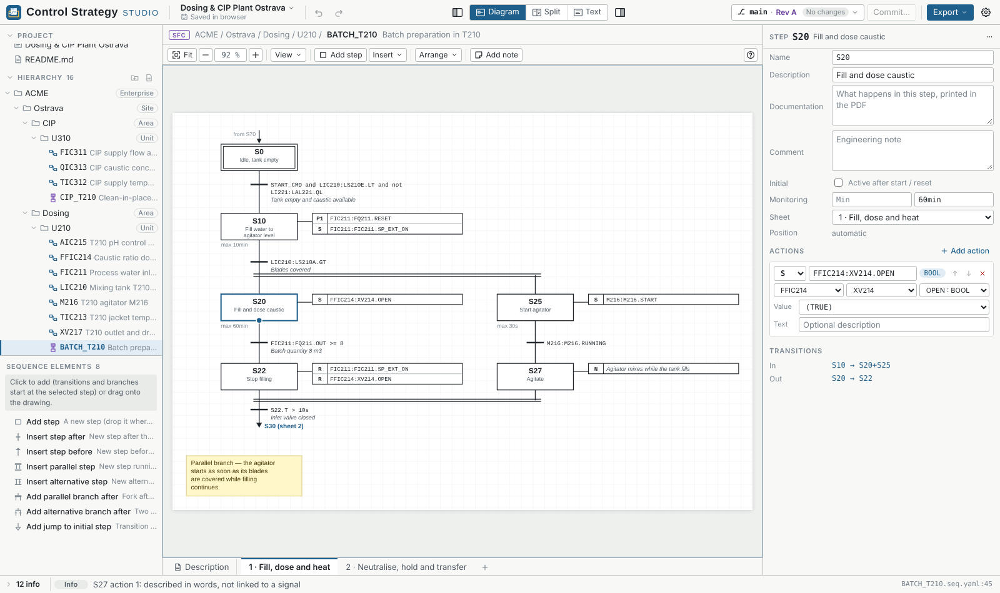

# User guide

A tour of the editor: where things are, how to draw continuous strategies and
sequences, how projects are stored and versioned, and how to hand them over.
For the files themselves see [file-format.md](file-format.md).

- [The window](#the-window)
- [Projects: open, save, folders](#projects-open-save-folders)
- [Continuous strategies (function block diagrams)](#continuous-strategies-function-block-diagrams)
- [Sequences (SFC)](#sequences-sfc)
- [Text view](#text-view)
- [Block types and libraries](#block-types-and-libraries)
- [Documentation](#documentation)
- [Versions: commits, revisions, branches](#versions-commits-revisions-branches)
- [Export and hand-over](#export-and-hand-over)
- [Settings](#settings)
- [Problems and validation](#problems-and-validation)

## The window



```
┌───────────────────────────────────────────────────────────────────────────────┐
│ Logo │ Project ▾ / save state │ ↶ ↷ │   ▐ Diagram|Split|Text ▌   │ ⎇ main ▾ Commit… │ Export ▾ ⚙ │
├─────────────┬───────────────────────────────────────────────┬─────────────────┤
│ Project     │  canvas (drawing)  │  text (YAML)             │ Properties      │
│ tree        │                    │                          │ (inspector)     │
│ Blocks      │                    │                          │                 │
│ (palette)   │                                               │                 │
├─────────────┴───────────────────────────────────────────────┴─────────────────┤
│ Problems                                                                      │
└───────────────────────────────────────────────────────────────────────────────┘
```

The top bar has four groups, left to right:

| Group | What it holds |
|---|---|
| **Project** | The project name opens the project menu: its save state (browser, folder, *changed outside*), new / open folder / open ZIP / examples / recent projects, save as ZIP, save to folder, project settings and delete. The line under the name always shows where the project is saved. |
| **Edit** | Undo / redo (`Ctrl+Z` / `Ctrl+Y`) — every change, from the canvas, inspector or text. |
| **View** | Left panel · **Diagram / Split / Text** (`Alt+1/2/3`) · right panel (`Ctrl+B`, `Ctrl+Alt+B`). |
| **Version and output** | `⎇ branch · changes ▾` opens the Version menu (history, compare, text diff, branches, revisions); **Commit…**; **Export ▾** (PDF, interactive HTML, JSON / TOML); **Settings** (gear, `Ctrl+,`). |

The **left panel** holds the project tree (README, hierarchy folders, strategies,
sequences, libraries, assets) and the block palette. The **right panel** (inspector)
shows the properties of what is selected: a block, a link, a step, the strategy itself.
Its list of problems and hints can be collapsed so that only the fields stay.
The **Problems** bar at the bottom lists all diagnostics of the project; click one to
jump to it.

Press `?` on a canvas for all its shortcuts.

## Projects: open, save, folders

A project is a folder of text files. The editor keeps it in one of three places:

* **In this browser** (always) — every change is saved automatically. *Recent
  projects* in the project menu lists the projects kept in this browser.
* **As a ZIP file** — *Save as ZIP* (`Ctrl+S`) downloads the whole project including
  its git history; *Open ZIP…* opens one again. Use it to share or archive a project.
* **In a folder on disk** (Chrome / Edge) — *Open folder…* opens a project folder,
  *Save to folder…* links the current project to an (empty) folder. From then on every
  change is written to the folder, and the git history lives in its `.git`, so you can
  use ordinary git tools, a text editor or a file sync next to the app.
  * When the folder changes outside the app (a `git pull`, another editor), the app
    notices when its window gets the focus again and offers *Load from folder* or
    *Write app version to folder* — nothing is overwritten silently.
  * After a browser restart the browser asks once for permission to the folder
    again: the status line shows *Reconnect folder …*; one click is enough.
  * *Disconnect folder* stops writing to it; the files stay where they are.

*Open example* offers small demo projects and *Dosing & CIP Plant Ostrava* — a
larger plant with continuous strategies, sequences, a company library and
documentation with charts.

## Continuous strategies (function block diagrams)

A continuous strategy (`NAME.yaml`) is a CFC-like diagram of blocks and links.

**Blocks**
* Drag a block from the palette, or double-click the paper / press `/` and type its
  name (quick insert).
* Blocks show their inputs left and outputs right; unconnected inputs can hold a
  constant, shown next to the port. Parameters can be shown or hidden per block or
  for the whole project.
* Execution order is shown in the block header; *Arrange → Auto order* numbers the
  blocks by signal flow.
* Positions are stored only for blocks you moved; everything else is laid out
  automatically, so a strategy written as text is drawn tidy without coordinates.

**Links**
* Drag from an output to an input (or the other way). Lines are routed around
  blocks and never run on top of each other.
* To reconnect a link, drag a connected input to another input; `Shift` + drag a
  connected output to another output moves the source instead. Label, category and
  comment stay.
* Signals from other strategies (`STRATEGY:BLOCK.PORT`) are drawn as off-page
  connectors; the other strategy shows a *used by* tag automatically.
* **Planned links** mark where a signal will come from or go to before the other
  side exists (right-click a port → *Add planned source / destination…*). They are
  grey dashed arrows; once the named signal exists, one click makes them real links.
* Links can carry a **category** (e.g. interlock, alarm, tracking) with its own
  colour, line style and width; links without one use the default line.

**Sheets** — a strategy can have several sheets (tabs above the canvas). Links between
sheets are drawn as off-sheet connectors.

**Canvas tools**
* *Find* (`Ctrl+F`) — a block on any sheet, then shows it.
* Minimap (View menu) for large sheets.
* Rubber-band selection (includes notes), align and distribute (Arrange menu).
* **Scan time bands** (View → *Scan time bands*, optional): *Arrange → Arrange by
  scan time* puts blocks with the same scan (100 ms, 500 ms, 1 s …) into columns and
  draws dividing lines with the scan of each band.
* Notes — free text boxes on the paper.

**Composite blocks** have an inner diagram; open one from the library to edit it.
Its interface bars (inputs left, outputs right) can be moved like blocks.

## Sequences (SFC)

A sequence (`NAME.seq.yaml`) is a step chain in the style of IEC 61131-3 SFC /
Grafcet. Design notes: [design/sequences.md](design/sequences.md).



* **Steps** carry actions with qualifiers (`N`, `S`, `R`, `P1`, `D`, `L` …) that
  write inputs of continuous strategies (`set: FIC101:FIC101.SP_EXT_ON`) or are
  described in words (`text:`), and optional min / max times.
* **Transitions** have a condition in a small expression language:
  `LIC210:LS210A.GT and S40.T >= 5min`. Completion and hover help work in the
  inspector and the text view.
* **Branches** — one transition to several steps starts a parallel branch, several
  transitions from one step form an alternative branch.
* **Inserting** — drag a step, transition or a whole branch from the palette onto
  the chain: the target is highlighted (top of a step = before, bottom = after,
  middle = beside, on a transition = into it). `Ctrl+Enter` / `Ctrl+Shift+Enter`
  insert a step after / before the selected one.
* **Sequencers** — a sequence can hold several step chains (e.g. *Running*,
  *Holding*, *Aborting*), each with a start condition and a priority, shown as
  sub-tabs of the sheet. The *ISA-88* preset adds the procedural states
  (`SEQ.RUNNING`, `SEQ.HOLDING` …) as signals.
* Continuous strategies can read sequence states (`BATCH_T210:S50.X`,
  `BATCH_T210:SEQ.RUNNING`).

## Text view

Every strategy, sequence and block type is a YAML file, and the text view edits
exactly that file. Drawing and text stay in sync in both directions, including
`#` comments and formatting. The editor offers:

* completion of block types, ports, parameters, signals and step names,
* hover help for types, ports and conditions,
* problem markers (same diagnostics as the Problems bar),
* selection that follows: select a block on the canvas and the text scrolls to it.

*Split* shows the drawing and the text side by side.

## Block types and libraries

* `library/std` is the standard library (I/O, logic, timers, comparators, math,
  selectors, filters, PID, ratio, split range, motor, valve, interlock …).
* Own libraries are plain folders next to it (`library/acme/…`) — copy them between
  projects as they are.
* A block type is defined by its interface: inputs, outputs and parameters with types,
  defaults, units and descriptions. Optionally an implementation (`language`,
  `source`) or an inner diagram (composite block).
* Types are versioned (`PID@1.0.0.yaml`); a strategy can pin a version or use the
  latest.
* Open a block type from the tree for the graphical type editor.

## Documentation

* `README.md` of the project and of each hierarchy folder, and `NAME.md` next to each
  strategy or sequence (its function description), written in Markdown.
* Images go to `assets/`; charts can be written as data blocks and are drawn in the
  editor, the HTML export and the PDF.
* Each block, link and step has a short *description* and an optional *comment*.

## Versions: commits, revisions, branches

The project carries its own git repository (in the browser, the ZIP or the folder's
`.git`).

* **Commit…** (`Ctrl+Shift+C`) stores the current state with a message; the
  dialog lists the changed files with a readable summary per strategy.
* **History** (`Ctrl+Shift+H`, or the Version menu) — all commits with what changed.
* **Compare with** — shows the differences to an older version right on the canvas
  (added, changed and removed blocks, links, steps).
* **Show changes** — text diff of the uncommitted changes.
* **Revisions** — mark a commit as *Rev A*, *Rev B* …; the revision is printed in the
  title blocks of the exports.
* **Branches** — try a variant (`moc-042-retune`) and switch back.
* From the history you can restore a strategy or the whole project to an older version.

## Export and hand-over

**Export ▾** in the top bar (`Ctrl+E`):

| Format | Use |
|---|---|
| **PDF** | Printable documentation with cover, contents, title blocks, function descriptions, diagram sheets, parameter tables, cross references, library appendix and revision history. |
| **Interactive HTML** | One read-only file to click through in any browser (offline): tree, drawings, descriptions, cross references. |
| **JSON / TOML** | Project data for other tools and scripts. |

Each export can be limited to chosen strategies and sequences and to chosen
sections; the choice is remembered per project.

## Settings

The gear (`Ctrl+,`) opens three tabs:

* **Project** — name, description, author, hierarchy level names (none, ISA-95,
  ISA-88 or your own; only labels, never enforced) and the title block (logo,
  drawn / checked / approved).
* **Drawing style** — default line and line categories (colour, line style, width),
  marking of previous-cycle (feedback) links, parameters shown on blocks by default.
* **Editor** — you (author name and e-mail for commits), the start view and canvas
  display: grid, minimap, scan time bands, parameters and pins. These preferences stay
  in this browser.

Project and drawing settings are stored in `project.yaml`, so they travel with the
project.

## Problems and validation

The project is validated continuously. Every problem has a severity (error,
warning, info) and a stable code — the full list with explanations is in
[diagnostics.md](diagnostics.md). Problems appear in the Problems bar, in the
inspector of the affected item, as markers on the canvas and in the text view.
